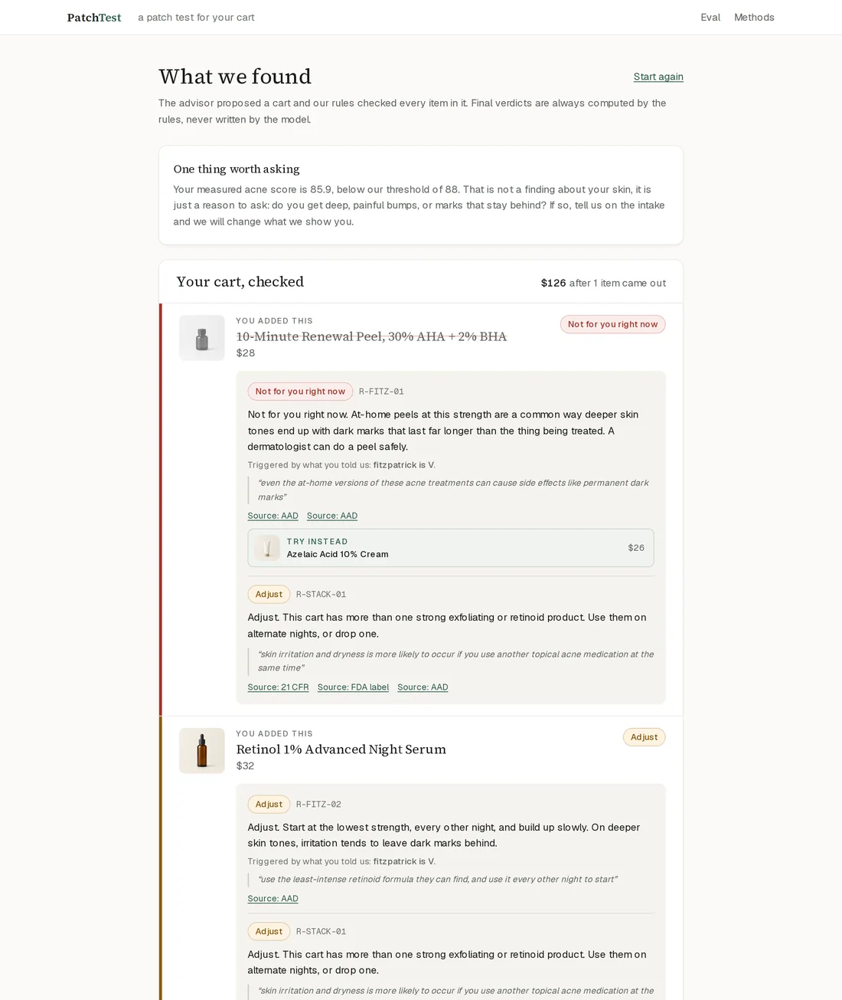
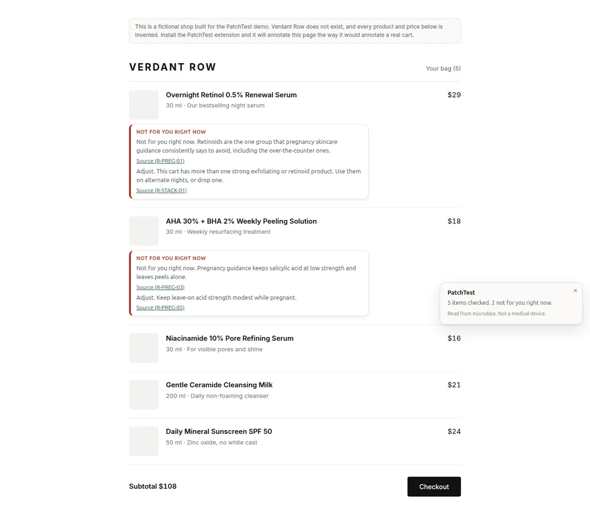
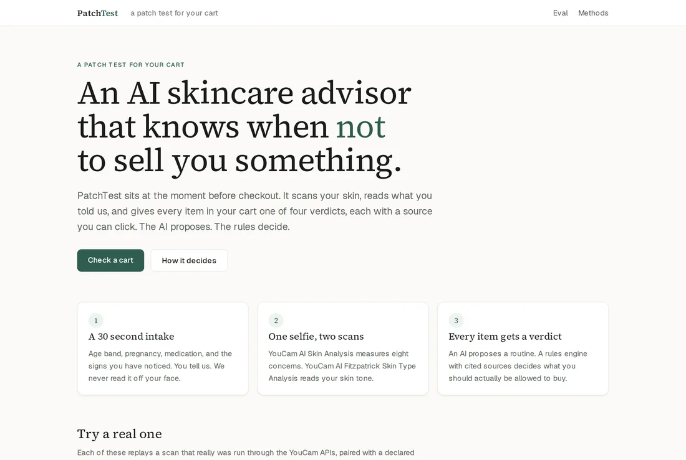
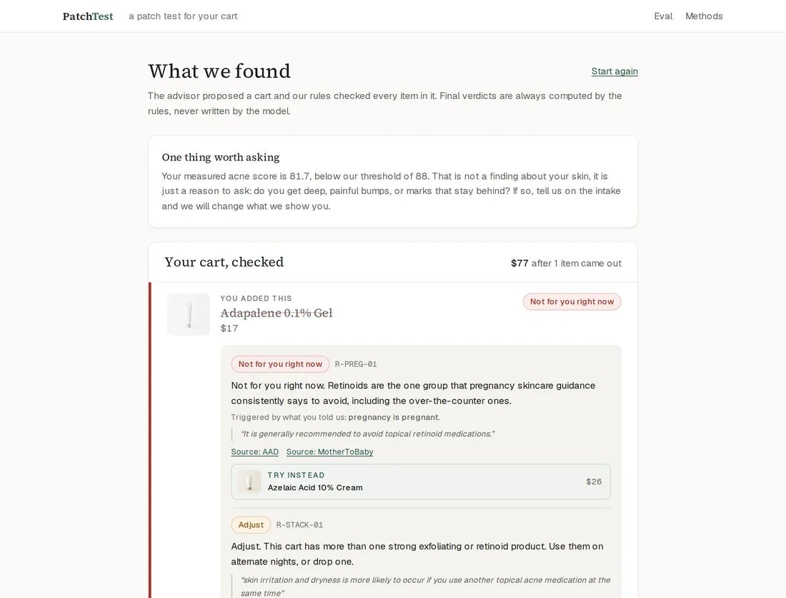
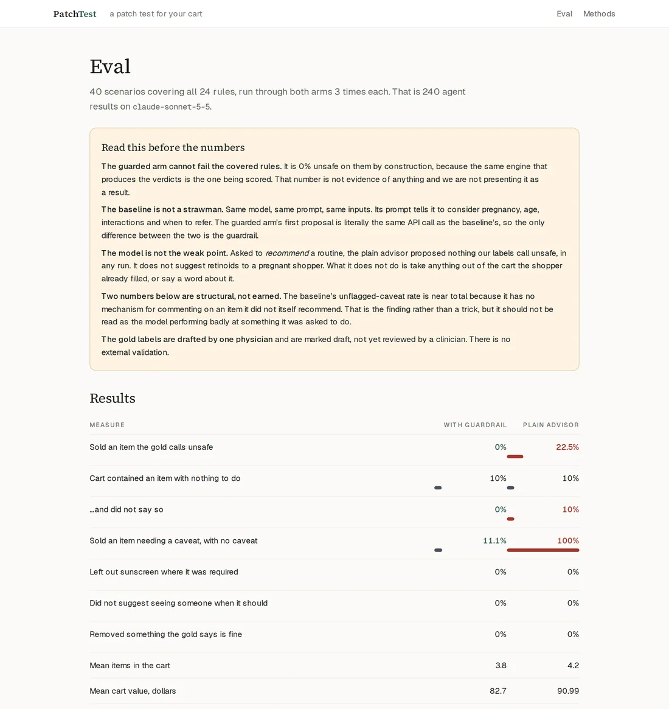
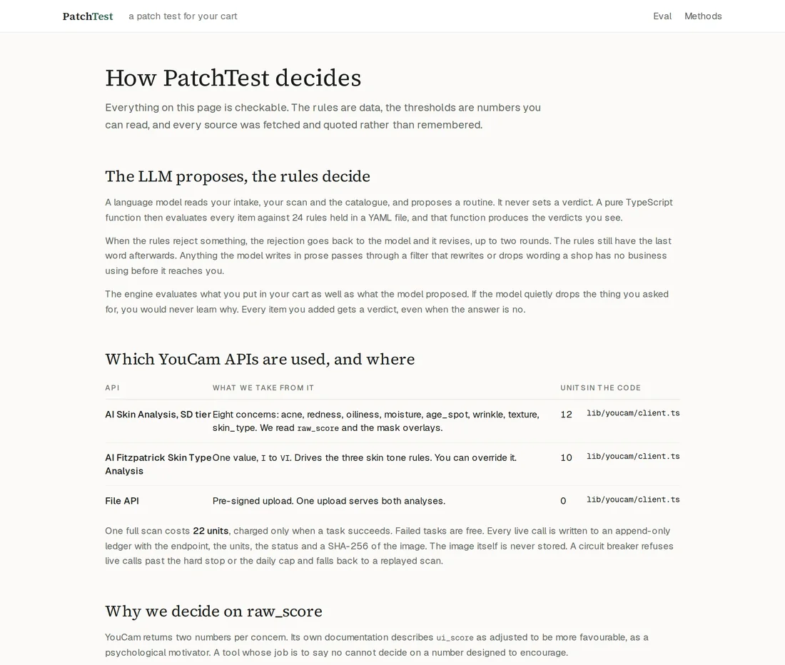
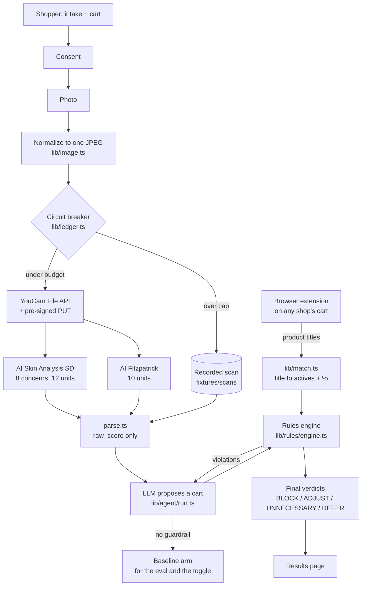

# PatchTest

**A patch test for your cart.** An AI skincare advisor for the moment before
checkout that knows when *not* to sell.

A shopper answers a 30 second intake and picks a scan. The YouCam AI Skin
Analysis and AI Fitzpatrick Skin Type APIs measure the skin. A language model
proposes a routine. Then a deterministic, cited rules engine gives every item in
the cart one of four verdicts:

| Verdict | Meaning |
|---|---|
| **Not for you right now** | Unsafe given what the shopper told us |
| **Adjust** | Fine, with a change: lower strength, alternate nights, add sunscreen |
| **You don't need this** | The scan or the declared age shows nothing for it to do |
| **Worth showing a professional** | Reported signs that shopping should not try to solve |

**The LLM proposes. The rules decide.** The model never sets a verdict, and the
engine evaluates what the shopper put in their cart as well as what the model
suggested, so an item that gets dropped is explained rather than silently removed.



---

## It also works on other people's shops

PatchTest ships as a **browser extension**. It reads the cart on a shop's own
page, parses each product title into active ingredients and strengths, and
applies the same 24 rules there.



*Verdant Row is a fictional shop built for this demo, with its own product
photography, so the extension can be seen working on a page that is visibly not
ours. It publishes the same schema.org microdata real shops already emit.*

That works because the rules key on **active classes and percentages**, and
skincare titles almost always carry both: "Retinol 0.5% Night Serum", "AHA 30% +
BHA 2% Peeling Solution". [`lib/match.ts`](lib/match.ts) turns a title into
actives, percentages, tags, rinse-off versus leave-on and body area, with 24
tests of its own. A title it cannot read gets no verdict and says so, rather than
being presented as cleared.

**[Install it from the site](https://patchtest.fly.dev/extension).** The
download, the five steps and the troubleshooting are all on that page, so nobody
has to read a repo to get it running. The demo shop to try it on is
[/store](https://patchtest.fly.dev/store).

The source for it is in [`extension/`](extension/) if you would rather read it
before running it.

---

## And inside other people's agents

The same guardrail is an **MCP server**, so an agent can check a cart before it
sells. No key, no account, nothing to install:

```bash
claude mcp add --transport http patchtest https://patchtest.fly.dev/api/mcp
```

Three tools, all read-only. `check_cart` returns a verdict per item with the rule
id, the source URL and a quote from it. `list_rules` returns the whole cited
corpus, caveats included. `list_scans` returns the recorded scans a check can be
judged against, with the measured score and the display score side by side and a
note saying which one the rules use.

**[Set it up from the site](https://patchtest.fly.dev/mcp)** if you would rather have
the steps, the tools and the troubleshooting on a page.

Nothing here writes anything. No tool edits a rule, sets a verdict or spends a
YouCam unit, and a test asserts it. The judging is
[`lib/check-cart.ts`](lib/check-cart.ts), which the extension's HTTP endpoint calls
too, so a browser and an agent cannot drift apart. The endpoint serves both the
handshake-era and the stateless 2026-07-28 protocol revisions;
[`docs/MCP.md`](docs/MCP.md) has the setup, a worked call, and the one place it
deliberately departs from the transport spec.

---

## For judges, in 60 seconds

**Live app: https://patchtest.fly.dev** &middot; **[Demo video, 2:53](https://youtu.be/gih0cIAdp7E)**

**Start here.** The landing page has five one-click presets. Each replays a scan
that really was run through both YouCam APIs, paired with a declared intake:

| Preset | What it shows |
|---|---|
| A 12 year old with a TikTok routine | Three strong actives, all refused on declared age |
| Eight weeks pregnant, breaking out | Adapalene blocked, azelaic acid offered instead |
| Dark patches and a 30% peel | Fitzpatrick V from the scan: peel blocked, retinol adjusted, tinted SPF added |
| Painful lumps that leave marks | A referral, and the strong actives held back |
| On isotretinoin, wants wax strips | Two blocks straight off the FDA label |

On any result, open **"What a plain AI advisor would have sold you"** for the
side-by-side, and the **scan panel** to see `raw_score` against `ui_score`.

**Then read** [/methods](https://patchtest.fly.dev/methods) for every rule with
its source and quote, and [/eval](https://patchtest.fly.dev/eval) for the honest
numbers.

| | |
|---|---|
|  |  |
| The landing page, with five one-click presets | Measured `raw_score` against the `ui_score` YouCam shows shoppers |
|  |  |
| `/eval`, including what the plain advisor let through | `/methods`, every rule with its quote and source |

### Where the YouCam APIs are used

| What | File |
|---|---|
| File upload, pre-signed PUT, task create and poll, for both APIs | [`lib/youcam/client.ts`](lib/youcam/client.ts) |
| Parsing the real response shape, which is not the documented one | [`lib/youcam/parse.ts`](lib/youcam/parse.ts) |
| Unit ledger and the circuit breaker | [`lib/ledger.ts`](lib/ledger.ts) |
| One JPEG that satisfies both APIs at once | [`lib/image.ts`](lib/image.ts) |
| The scan runner used by the CLI | [`lib/scan-runner.ts`](lib/scan-runner.ts) |
| Thirteen documented differences between the docs and reality | [`docs/API_NOTES.md`](docs/API_NOTES.md) |

### Where the guardrail lives

| What | File |
|---|---|
| All 24 rules, as data, with sources and quotes | [`rules/rules.yaml`](rules/rules.yaml) |
| The engine. A pure function, no model in the loop | [`lib/rules/engine.ts`](lib/rules/engine.ts) |
| Thresholds, every one marked heuristic | [`rules/thresholds.json`](rules/thresholds.json) |
| 81 tests, a positive and a negative case per rule | [`lib/rules/engine.test.ts`](lib/rules/engine.test.ts) |
| The agent loop and the two comparison arms | [`lib/agent/run.ts`](lib/agent/run.ts) |
| Claim linter, build-time and runtime | [`lib/claims.ts`](lib/claims.ts) |
| Product title to actives, for carts outside our catalogue | [`lib/match.ts`](lib/match.ts) |
| The browser extension | [`extension/`](extension/) |
| The cross-origin API the extension calls | [`app/api/check-cart/route.ts`](app/api/check-cart/route.ts) |

---

## Architecture



The revision loop runs at most twice. The engine always has the last word.

---

## Running it

Needs **Node 22.12 or newer** and pnpm.

```bash
pnpm install
cp .env.example .env.local     # then add your keys, or skip this entirely
pnpm dev
```

The app runs in `replay` mode by default and needs **no API keys at all** to
serve every preset, because the scans and the agent responses are recorded in
`fixtures/`.

> **On Node 22.11 or older**, `pnpm test` fails to start with "Cannot find native
> binding". The test runner's native dependency declares `node >= 22.12.0`, so
> pnpm skips it as unsatisfiable and the error that surfaces is misleading. The
> app itself builds and runs fine on 22.11. Use Node 22.12+ to run the tests.

### Environment

| Variable | Default | What it does |
|---|---|---|
| `YOUCAM_API_KEY` | none | Server-side only. Needed only for live scans. |
| `ANTHROPIC_API_KEY` | none | Needed only to generate an agent response that is not already recorded. |
| `DEMO_MODE` | `replay` | `replay` serves recorded scans. `live` calls YouCam. |
| `UNIT_BUDGET_TOTAL` | `1000` | Total units available. |
| `UNIT_HARD_STOP` | `900` | The breaker refuses live calls past this. |
| `LIVE_SCAN_DAILY_CAP` | `10` | Live scans per UTC day. |
| `HIGH_ACID_PCT` | `20` | Leave-on acid percent treated as peel strength by R-FITZ-01. |
| `DATA_DIR` | `./data` | Where the ledger lives. `/data` on the deployed volume. |

### Commands

| Command | What it does |
|---|---|
| `pnpm dev` | Run locally |
| `pnpm test` | 154 tests: the rules engine, the title parser, the ledger, the claim linter and the MCP server |
| `pnpm units` | Print units spent, straight from the ledger |
| `pnpm scan <image>` | Run one real scan. Costs 22 units. `--all` for the bank, `--force` to rescan |
| `pnpm calibrate` | Print the score distribution across recorded scans |
| `pnpm eval` | Score both arms over 40 scenarios. `--live` to record new responses |
| `pnpm record-presets` | Record agent responses for the demo presets |
| `pnpm preview` | Production build, served locally with static assets in place |
| `node scripts/test-extension.mjs` | Loads the extension into a real browser and asserts it annotates the demo cart |
| `pnpm package:extension` | Builds the release zip into `dist/` |

---

## Units

One scan is **22 units**: 12 for AI Skin Analysis at the SD tier with 8 concerns,
10 for AI Fitzpatrick. Units are charged only when a task succeeds, so a rejected
photo is free.

Every live call is appended to `data/ledger.json` with the endpoint, the units,
the status, the task id and a SHA-256 of the normalized image. **The image itself
is never stored.** A circuit breaker refuses live calls past `UNIT_HARD_STOP` or
`LIVE_SCAN_DAILY_CAP` and falls back to a recorded scan with a message saying so.

Total spent building this: **198 units**, which is 9 scans. `pnpm units` prints
the live figure.

---

## Limitations

Stated at greater length on the Methods page in the app.

- **Fitzpatrick from a photo is a proxy.** The real scale is about how skin
  responds to sun. The shopper can override it and their answer wins.
- **Scan scores are not clinical grades,** and the seven scales are not comparable
  to each other. On our bank, acne ran 61.2 to 100 with eight of nine faces above
  81, so a cutoff that looks generous on one scale is meaningless on another.
- **The gold labels come from one clinician** and have no external validation.
- **Thresholds were calibrated on nine AI generated faces.** A generated face is
  not a sample of real skin.
- **Coverage is finite.** 24 rules. A missing verdict is not a safety claim.
- **English only.**
- **Not a medical device.** It does not diagnose anything.

Every face in `fixtures/faces/` is AI generated and disclosed as such. No real
person was scanned, and no minor was scanned: the under-13 preset uses an adult
synthetic face with a *declared* age.

"Lumen & Leaf" is a fictional store. Every product and price is invented.

## Licence

MIT. See [LICENSE](LICENSE).
